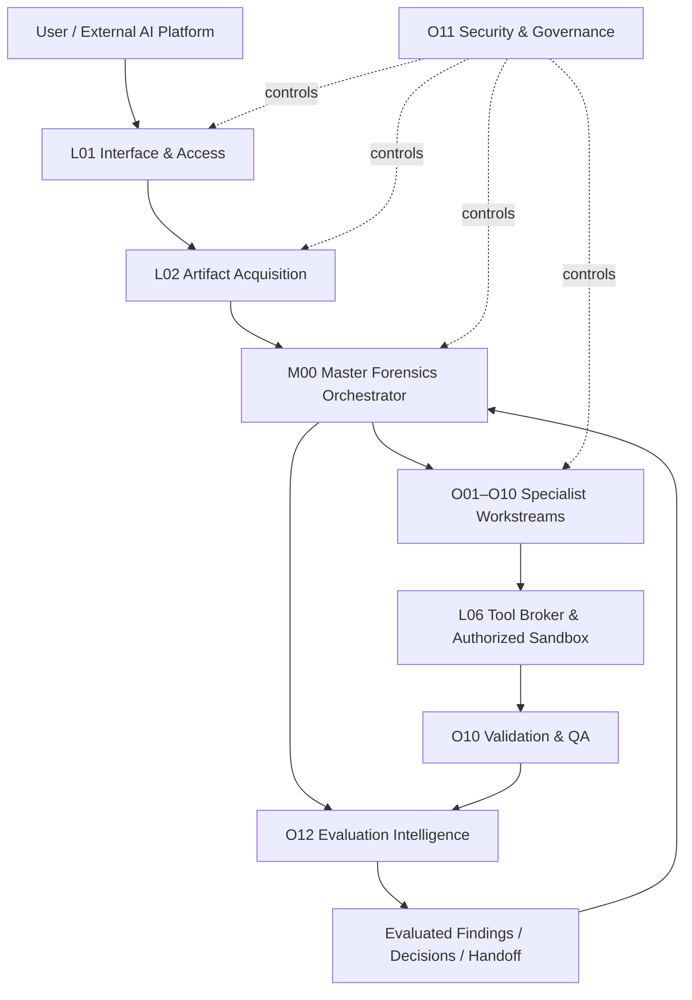

# A.S.F.R.E.E Architecture Definition Package — v1.0

## Product mission

Understand and improve authorized technical systems using evidence, modular analysis and supervised engineering. Deliver not just a report, but a testable path from observations to controlled changes and outcome evaluation.

## Core topology

The diagram is logical. It does not claim these services are deployed.

## Design principles

- Evidence before conclusions.
- Read-only by default.
- Human-supervised modifications.
- Least privilege.
- Modular responsibility.
- Separation of analysis and execution.
- Preservation of verified strengths.
- Independent verification.
- Reproducible and reversible engineering.
- Explicit uncertainty and residual risk.
- No fabricated capabilities or execution evidence.

## The 12 orchestrators

M00 coordinates O01 Artifact Intelligence; O02 Anatomy & Decomposition; O03 Positive Intelligence; O04 Negative Intelligence; O05 Comparative Intelligence; O06 Bug Detection & Diagnosis; O07 Remediation & Bug Fixing; O08 Reconstruction & Adaptation; O09 Integration & Runtime Laboratory; O10 Validation & QA; O11 Security & Governance; O12 Evaluation Intelligence.

O11 is a cross-cutting authorization/security plane. O12 is a cross-cutting evaluation control plane. O10 performs test work; O12 judges whether the criteria and resulting evidence support the intended decision.

## Priority components

1. Evidence management and provenance.
2. Master orchestration and shared contracts.
3. Supervised change and independent verification.

Do not instantiate all specialist procedures as agents prematurely. Start with the smallest reliable architecture; split further only when single-responsibility boundaries, load or testability justify the cost.

## Open implementation decisions

Language, backend framework, database, workflow engine, cloud provider, model strategy, identity provider, tool vendors, deployment topology, workload targets and budget remain TBD. Choose after threat model, workload and cost envelope exist.
